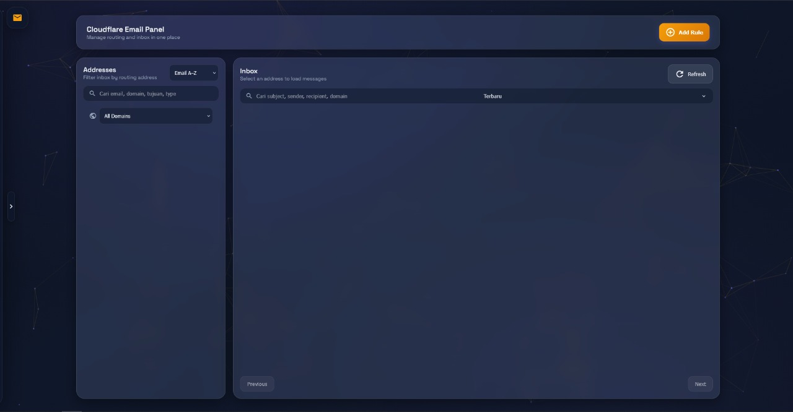

# Cloudflare Email Panel

[](LICENSE)
[](https://nodejs.org/)
[](https://www.docker.com/)
[](https://www.cloudflare.com/)

Self-hosted panel to manage Cloudflare Email Routing, destinations, rules, and inbox (via D1). Production uses Docker, Caddy, and automatic HTTPS.

## Screenshot



## Features

- **Email Routing Management** - Create, update, and delete forwarding rules
- **Destinations** - Manage email destinations (forwarding addresses)
- **Inbox System** - Store incoming emails using Cloudflare D1 + Worker
- **Catch-All Rules** - Configure catch-all email routing
- **Worker Integration** - Route emails to Cloudflare Workers
- **Password Protection** - Secure your panel with password authentication
- **Diagnostics** - Check Cloudflare API connectivity and permissions
- **Dark Mode** - Beautiful dark theme with responsive design
- **Security First** - CSP, HSTS, rate limiting, and more

## Architecture

```
┌─────────────────────────────────────────────────────────────┐
│                      Your VPS                               │
├─────────────────────────────────────────────────────────────┤
│  ┌─────────┐     ┌─────────────────────────────────────┐   │
│  │  Caddy  │────▶│        Cloudflare Email Panel        │   │
│  │ (HTTPS) │     │            (Node.js)                 │   │
│  └─────────┘     └─────────────────────────────────────┘   │
│   :80, :443                    :3000                        │
└─────────────────────────────────────────────────────────────┘
                           │
                           ▼
┌─────────────────────────────────────────────────────────────┐
│                   Cloudflare                                 │
├─────────────────────────────────────────────────────────────┤
│  ┌─────────────┐  ┌─────────────┐  ┌─────────────────────┐ │
│  │Email Routing │  │   Workers   │  │    D1 Database      │ │
│  │   (Rules)   │  │  (Inbox)    │  │   (Email Storage)   │ │
│  └─────────────┘  └─────────────┘  └─────────────────────┘ │
└─────────────────────────────────────────────────────────────┘
```

## Prerequisites

- **VPS**: Ubuntu or Debian with root access
- **Cloudflare Account**: With Email Routing enabled
- **Domain**: Added to Cloudflare with DNS pointing to your VPS
- **Firewall**: Ports 80 and 443 open
- **SSL/TLS Mode**: Full (strict) in Cloudflare

## Quick Start (Docker)

### 1. Clone the repository

```bash
git clone https://github.com/baaaaan1/Cloudflare-mail.git
cd Cloudflare-mail
```

### 2. Run the installer

```bash
sudo bash scripts/install_vps.sh
```

The installer will:
- Install Docker Engine + Compose (if not present)
- Create `.env` from template
- Prompt for your domain
- Open `.env` for editing
- Build and start the containers

### 3. Configure credentials

Edit `.env` with your Cloudflare credentials:

```env
PORT=3000
CADDY_DOMAIN=your-domain.com
CLOUDFLARE_API_TOKEN=your_api_token
CLOUDFLARE_ACCOUNT_ID=your_account_id
CLOUDFLARE_D1_DATABASE_ID=your_d1_database_id
PASSWORD_HASH=
PASSWORD_SALT=
```

### 4. Set up password

1. Open your panel at `https://your-domain.com`
2. You'll see the setup screen
3. Enter your desired password (minimum 8 characters)
4. The password hash will be saved to `.env`

Alternatively, generate the hash outside the panel:

```bash
node scripts/generate-password.js --password "your-secret"
# or interactive:
node scripts/generate-password.js
```

Copy the printed `PASSWORD_SALT=` and `PASSWORD_HASH=` into `.env`.

### 5. Access your panel

```
https://your-domain.com
```

### Non-root container & `.env` permissions

The panel container runs as a **non-root** user (UID 1000). When you bind-mount
`.env` from the host, it must be writable by that UID so the Settings/setup-password
UI can save changes. The `install_vps.sh` script handles this automatically; for a
manual setup run:

```bash
chown 1000:1000 .env
chmod 600 .env
```

## Manual Installation (without Docker)

### 1. Install Node.js 22+

```bash
curl -fsSL https://deb.nodesource.com/setup_22.x | sudo -E bash -
sudo apt-get install -y nodejs
```

### 2. Clone and install dependencies

```bash
git clone https://github.com/baaaaan1/Cloudflare-mail.git
cd Cloudflare-mail
npm ci
```

### 3. Configure environment

```bash
cp .env.example .env
# Edit .env with your credentials
```

### 4. Start the server

```bash
npm start
```

The panel will be available at `http://localhost:3000`.

## Deploy with Dokploy (self-hosted)

Dokploy builds directly from GitHub using Docker Compose. A dedicated compose file
is included at [`docker-compose.dokploy.yml`](docker-compose.dokploy.yml) — it runs
only the panel and lets Dokploy's built-in Traefik proxy handle TLS + domains.

1. In Dokploy, create a **Docker Compose** service with source **GitHub** → this repo.
2. In **General**, set the compose file path to `docker-compose.dokploy.yml`.
3. In **Environment**, add the required variables (set them in the UI, not in the panel):

   ```env
   PORT=3000
   CLOUDFLARE_API_TOKEN=your_api_token
   CLOUDFLARE_ACCOUNT_ID=your_account_id
   CLOUDFLARE_D1_DATABASE_ID=your_d1_database_id
   PASSWORD=your-login-password
   ADMIN_API_TOKEN=optional_script_token
   ```

   `PASSWORD` is your plain login password — the server auto-generates
   `PASSWORD_SALT`/`PASSWORD_HASH` from it at startup (a fresh random salt every
   boot). Prefer pre-computed values? Set `PASSWORD_HASH` + `PASSWORD_SALT`
   instead, generated with:

   ```bash
   node scripts/generate-password.js --password "your-secret"
   ```

4. In **Domains**, add your domain. Dokploy routes traffic to the panel (internal
   port 3000) and issues the TLS certificate automatically.

> **Note:** Because the container runs as non-root (UID 1000) and Dokploy regenerates
> `.env` on every deploy, do **not** rely on the panel's own "Set password"/"Save
> Settings" screens to write `.env`. Set all values in the Dokploy **Environment**
> tab instead.

## Configuration Reference

| Variable | Required | Description |
|----------|----------|-------------|
| `PORT` | No | Server port (default: 3000) |
| `CADDY_DOMAIN` | Yes | Your domain (e.g., `mail.example.com`) |
| `CLOUDFLARE_API_TOKEN` | Yes | Cloudflare API token with required permissions |
| `CLOUDFLARE_ACCOUNT_ID` | Yes | Your Cloudflare account ID |
| `CLOUDFLARE_D1_DATABASE_ID` | No | D1 database ID (required for inbox feature) |
| `PASSWORD_HASH` | No | Password hash (scrypt, hex). Optional if `PASSWORD` is set |
| `PASSWORD_SALT` | No | Password salt (hex). Optional if `PASSWORD` is set |
| `PASSWORD` | No* | Plain login password — `PASSWORD_SALT`/`PASSWORD_HASH` are generated automatically at startup. Easiest for Dokploy/Compose deploys |
| `ADMIN_API_TOKEN` | No | Optional token for scripted/remote API access (`Authorization: Bearer <token>` or `X-API-Key`) |

\* One of `PASSWORD`, or `PASSWORD_HASH` + `PASSWORD_SALT`, is required to protect the panel.

### Cloudflare API Token Permissions

Create a custom API token with these permissions:

- **Zone** → Email Routing → Edit
- **Zone** → Zone → Read
- **Account** → Workers Scripts → Edit (if using Workers)
- **Account** → D1 → Edit (if using Inbox)

## API Reference

### Authentication

| Endpoint | Method | Description |
|----------|--------|-------------|
| `/api/auth-status` | GET | Check authentication status |
| `/api/login` | POST | Login with password |
| `/api/logout` | POST | Logout |
| `/api/setup-password` | POST | Initial password setup |

**API token auth (optional):** set `ADMIN_API_TOKEN` in `.env`, then call any `/api/*`
endpoint (except login/logout/auth-status) with `Authorization: Bearer <token>` or
`X-API-Key: <token>` to authenticate without a cookie session. Mutating requests
authenticated via cookies require a matching `X-CSRF-Token` header, which is
returned by `/api/login` and `/api/session`.

### Destinations

| Endpoint | Method | Description |
|----------|--------|-------------|
| `/api/destinations` | GET | List all destinations |
| `/api/destinations` | POST | Create new destination |
| `/api/destinations/:id` | DELETE | Delete destination |

### Rules

| Endpoint | Method | Description |
|----------|--------|-------------|
| `/api/rules` | GET | List rules (requires `zoneId`) |
| `/api/rules` | POST | Create new rule |
| `/api/rules/:id` | PUT | Update rule |
| `/api/rules/:id` | DELETE | Delete rule |

### Inbox

| Endpoint | Method | Description |
|----------|--------|-------------|
| `/api/inbox/summary` | GET | Get inbox summary by recipient |
| `/api/inbox` | GET | List emails (supports `limit`, `offset`, `recipient`) |
| `/api/inbox/:id` | GET | Get email details |
| `/api/inbox/:id` | DELETE | Delete email |
| `/api/inbox/init` | POST | Initialize D1 database |

### Configuration

| Endpoint | Method | Description |
|----------|--------|-------------|
| `/api/config` | GET | Get current config |
| `/api/config` | POST | Update config |
| `/api/diagnostics` | GET | Check API connectivity |

### Health

| Endpoint | Method | Description |
|----------|--------|-------------|
| `/healthz` | GET | Liveness check |
| `/health` | GET | Health check with API verification |

## Worker Setup (Inbox)

The Worker stores incoming emails in D1 for viewing in the panel.

### 1. Create D1 Database

```bash
npx wrangler d1 create email-db
```

Note the `database_id` and add it to `.env`.

### 2. Configure Worker

```bash
cp worker/wrangler.toml.example worker/wrangler.toml
```

Edit `worker/wrangler.toml` and set `database_id`.

### 3. Deploy Worker

```bash
npm run deploy:worker
```

Or from VPS:

```bash
bash scripts/deploy_vps.sh --deploy-worker
```

### 4. Setup Email Routing

In Cloudflare Dashboard → Email Routing:
1. Add a catch-all rule or specific rule
2. Set action to "Send to Worker"
3. Select `inbox-worker`

## Development

### Local Development

```bash
cp .env.example .env
npm ci
npm run dev
```

The server will start with hot-reload at `http://localhost:3000`.

### Project Structure

```
├── server.js              # Express API server
├── public/                # Frontend (vanilla JS)
│   ├── index.html
│   ├── main.js
│   ├── styles.css
│   └── ...
├── worker/                # Cloudflare Worker
│   ├── src/index.js
│   ├── schema.sql
│   └── wrangler.toml.example
├── scripts/
│   ├── install_vps.sh     # AIO installer
│   └── deploy_vps.sh      # Deploy script
├── docker-compose.yml     # Production stack (VPS + Caddy)
├── docker-compose.dokploy.yml  # Dokploy (self-hosted) deployment
├── Dockerfile             # Node.js container
├── Caddyfile              # Reverse proxy config
└── .env.example           # Environment template
```

### Available Scripts

```bash
npm start          # Start production server
npm run dev        # Start development server with hot-reload
npm run deploy:worker  # Deploy Cloudflare Worker
```

## Security

- **Password Authentication** - Secure your panel with a password (scrypt, salted, timing-safe compare)
- **API Token Auth** - Optional `ADMIN_API_TOKEN` for scripted/remote access
- **Rate Limiting** - Protection against brute-force attacks
- **Login Lockout** - Temporary per-IP lockout after repeated failed logins
- **CSRF Protection** - Session-bound CSRF token required on mutating requests
- **Session Hardening** - HttpOnly, SameSite=Strict cookies, hashed session IDs, idle timeout
- **CSP Headers** - Content Security Policy to prevent XSS
- **HSTS** - HTTP Strict Transport Security
- **Secure Cookies** - HttpOnly, SameSite=Strict
- **Security Headers** - CSP, X-Content-Type-Options, X-Frame-Options, Referrer-Policy, Permissions-Policy, Cross-Origin-Opener-Policy, Cross-Origin-Resource-Policy
- **Non-root Container** - Panel runs as a non-root user inside Docker (`no-new-privileges`)
- **No Sensitive Data in Git** - `.env` and credentials are gitignored

### Reporting Vulnerabilities

If you discover a security vulnerability, please report it responsibly:

1. **DO NOT** open a public GitHub issue
2. Email security concerns to: [your-email@example.com]
3. Allow time for a fix before public disclosure

## Contributing

Contributions are welcome! Please see [CONTRIBUTING.md](CONTRIBUTING.md) for guidelines.

### Development Setup

1. Fork the repository
2. Create your feature branch (`git checkout -b feature/amazing-feature`)
3. Commit your changes (`git commit -m 'Add amazing feature'`)
4. Push to the branch (`git push origin feature/amazing-feature`)
5. Open a Pull Request

## License

This project is licensed under the ISC License - see the [LICENSE](LICENSE) file for details.

## Acknowledgments

- [Cloudflare](https://www.cloudflare.com/) for Email Routing, Workers, and D1
- [Caddy](https://caddyserver.com/) for automatic HTTPS
- [Express.js](https://expressjs.com/) for the web framework
- [PostalMime](https://github.com/nicktomlin/postal-mime) for email parsing

## Support

- **Documentation**: Read this README
- **Issues**: [GitHub Issues](https://github.com/baaaaan1/Cloudflare-mail/issues)
- **Discussions**: [GitHub Discussions](https://github.com/baaaaan1/Cloudflare-mail/discussions)

---

<<<<<<< Updated upstream
Made with ☕ by [baaaaan1](https://github.com/baaaaan1)
=======
Made with ☕ by [baaaaan1](https://github.com/baaaaan1)
>>>>>>> Stashed changes
