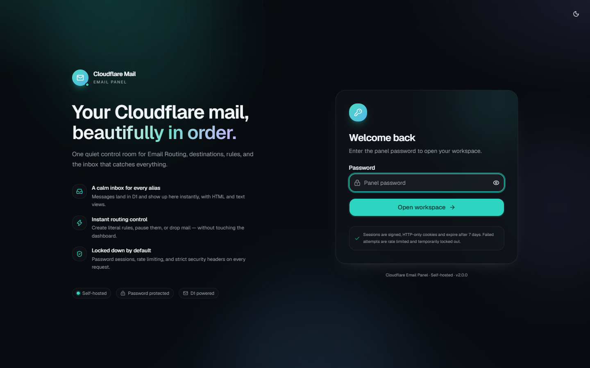
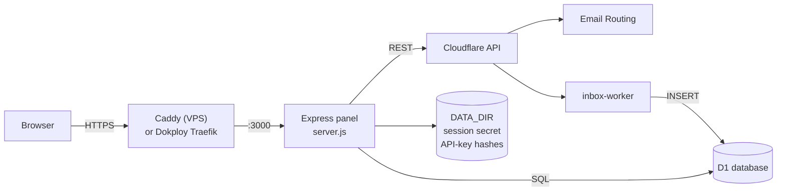
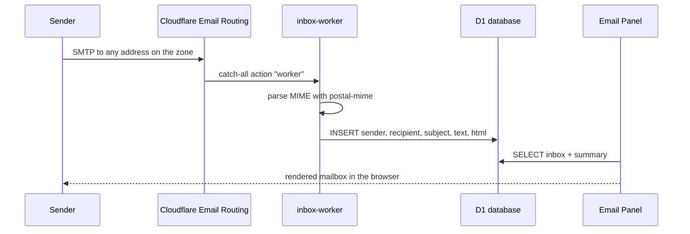

<h1 align="center">Cloudflare Email Panel</h1>

<p align="center">
  Self-hosted control plane for Cloudflare Email Routing, catch-all delivery, and a D1-backed inbox.
  <br />
  One password-protected panel, a production-ready Docker stack, and a REST API for automation.
</p>

<p align="center">
  <a href="LICENSE"></a>
  <a href="https://github.com/baaaaan1/Cloudflare-mail/releases"></a>
  <a href="https://nodejs.org/"></a>
  <a href="https://www.docker.com/"></a>
  <a href="https://developers.cloudflare.com/email-routing/"></a>
  <a href="ui/package.json"></a>
</p>

<p align="center">
  
</p>

## Table of Contents

- [Highlights](#highlights)
- [Architecture](#architecture)
- [Quick start (Docker)](#quick-start-docker)
- [Deployment](#deployment)
- [Configuration](#configuration)
- [Cloudflare setup](#cloudflare-setup)
- [Using the panel](#using-the-panel)
- [API reference](#api-reference)
- [Security](#security)
- [Development](#development)
- [Operations and troubleshooting](#operations-and-troubleshooting)
- [Contributing](#contributing)
- [Support my work](#support-my-work)
- [License](#license)

## Highlights

| Area | What you get |
|------|--------------|
| Email Routing | Create, edit, enable, disable, and delete routing rules across every zone in the account. |
| Destinations | Add and remove verified forwarding addresses. |
| Catch-all | Route unmatched mail to a Worker, a destination, or drop it entirely. |
| Inbox | A Cloudflare Worker stores parsed mail in D1; the panel reads, searches, and deletes it. |
| Disposable addresses | Generate a mailbox address from any active zone in one click; records expire after 7 days. |
| API access | Scoped API keys (`cfm_...`) with fine-grained permissions for scripts and integrations. |
| Operations | Overview dashboard, connectivity diagnostics, health endpoints, audit logs, and theme presets. |
| Security | Password sessions, rate limiting and lockout, optional Turnstile, strict headers, non-root panel, read-only containers. |

> The React/Vite SPA in `ui/` is the primary interface. When `ui/dist` is absent, the server
> falls back to the legacy vanilla-JS UI in `public/`.

## Architecture



<details>
<summary><strong>Inbound mail flow</strong></summary>



The Worker never forwards mail; it stores it. To keep forwarding instead, skip the routing
stage below or create explicit forwarding rules from the panel.
</details>

### Stack

| Layer | Technology |
|-------|------------|
| Frontend | React 19, TypeScript, Vite, Tailwind CSS v4, shadcn-style components, TanStack Query |
| Backend | Node.js 22, Express 4, Axios |
| Edge | Cloudflare Workers, Email Routing, D1 |
| Auth | Password session cookie (HMAC-SHA256) plus scoped API keys |
| Deployment | Docker, Docker Compose, Caddy or Dokploy/Traefik |

## Quick start (Docker)

### Prerequisites

- A Linux VPS (Ubuntu/Debian recommended) with Docker Engine and Docker Compose v2
- A Cloudflare account with Email Routing enabled for at least one zone
- A domain pointed at the VPS, with ports 80 and 443 reachable
- Cloudflare SSL/TLS mode set to **Full (strict)**

### 1. Clone and configure

```bash
git clone https://github.com/baaaaan1/Cloudflare-mail.git
cd Cloudflare-mail
cp .env.example .env
```

Edit `.env` and set at minimum:

```env
APP_PASSWORD=use-a-long-random-password
CADDY_DOMAIN=mail.example.com
CLOUDFLARE_API_TOKEN=your_api_token
CLOUDFLARE_ACCOUNT_ID=your_account_id
CLOUDFLARE_D1_DATABASE_ID=your_d1_database_id   # optional, enables the inbox
```

### 2. Start the stack

```bash
docker compose up -d --build
```

The image builds the SPA automatically. Caddy obtains a TLS certificate and proxies to the
panel on the internal port `3000`.

### 3. Sign in

Open `https://mail.example.com` and enter `APP_PASSWORD`. There is no sign-up: access is a
single password plus optional scoped API keys.

> **VPS installer:** `sudo bash scripts/install_vps.sh` (or `scripts/cliui.sh install`) automates
> Docker installation, `.env` creation, password generation, domain prompts, and startup.
> For scripted installs use `sudo bash scripts/cliui.sh install --domain mail.example.com --yes`.

## Deployment

<details>
<summary><strong>VPS with Caddy (docker-compose.yml)</strong></summary>

The default compose file runs two services:

| Service | Purpose |
|---------|---------|
| `panel` | Node.js app on internal port `3000`, read-only root filesystem, all capabilities dropped |
| `caddy` | TLS termination and reverse proxy, ports `80` and `443` |

```bash
docker compose up -d --build
docker compose ps
docker compose logs -f panel
```

Volumes:

- `auth_data` stores `DATA_DIR` (session secret and hashed API keys).
- `caddy_data` and `caddy_config` persist certificates and Caddy state.
- A writable `.env` bind mount lets the Settings page update Cloudflare credentials.

If you manage `.env` manually, make it writable by container UID 1000 so the Settings page can
save changes:

```bash
sudo chown 1000:1000 .env
sudo chmod 600 .env
```
</details>

<details>
<summary><strong>VPS CLI (scripts/cliui.sh)</strong></summary>

`scripts/cliui.sh` is the single entry point for Ubuntu/Debian VPS operations. It wraps
Docker Compose and Cloudflare provisioning, so routine maintenance does not require raw
compose commands.

Clone the repository first, then run the CLI from its root:

```bash
git clone https://github.com/baaaaan1/Cloudflare-mail.git
cd Cloudflare-mail
```

```bash
sudo bash scripts/cliui.sh              # interactive menu
sudo bash scripts/cliui.sh install      # Docker + .env + build + start
sudo bash scripts/cliui.sh run
sudo bash scripts/cliui.sh stop
sudo bash scripts/cliui.sh restart
sudo bash scripts/cliui.sh status
sudo bash scripts/cliui.sh logs
sudo bash scripts/cliui.sh cf-setup
sudo bash scripts/cliui.sh update
sudo bash scripts/cliui.sh uninstall
sudo bash scripts/cliui.sh uninstall --purge
```

| Command | Description |
|---------|-------------|
| `install` | Installs Docker, Compose, and git; creates `.env`; prompts for the domain; generates `APP_PASSWORD` when it is still the placeholder; builds and starts the stack; waits for health. |
| `run` | Starts the existing stack and prints the panel URL. |
| `stop` | Stops the containers while keeping data and `.env`. |
| `restart` | Recreates the containers from the current `.env` and waits for health. |
| `status` | Shows container state and probes `http://127.0.0.1:3000/healthz` inside the panel. |
| `logs` | Follows logs; use `--no-follow` to print once. |
| `cf-setup` | Runs `scripts/cf-setup.mjs` for D1, Worker, and Email Routing. |
| `update` | Runs `git pull`, rebuilds, and restarts. |
| `uninstall` | Removes the containers; `--purge` also removes volumes, local images, and `.env` after confirmation. |

Options: `--domain <name>` (install), `--yes`/`-y` (non-interactive), `--no-edit`
(do not open the `.env` editor), `--purge` (uninstall), and `--no-follow` (logs).

Shortcut wrappers call the same script: `scripts/install_vps.sh`, `scripts/run_vps.sh`,
`scripts/stop_vps.sh`, and `scripts/uninstall_vps.sh`.
</details>

<details>
<summary><strong>Dokploy (docker-compose.dokploy.yml)</strong></summary>

Dokploy builds the repository and routes traffic through its own Traefik instance, so this
compose file runs only the panel and exposes no host ports.

1. Create a **Docker Compose** service in Dokploy with source **GitHub** and this repository.
2. Set the compose file path to `docker-compose.dokploy.yml`.
3. In **Environment**, add `APP_PASSWORD`, `CLOUDFLARE_API_TOKEN`, `CLOUDFLARE_ACCOUNT_ID`, and
   optionally `CLOUDFLARE_D1_DATABASE_ID`.
4. In **Domains**, add your domain; Dokploy routes to the internal port and issues TLS.

`PORT` and `DATA_DIR` are fixed in the compose file to match the healthcheck and the
`auth_data` volume. The container root filesystem is read-only, so configure environment
variables in Dokploy rather than through the panel's Settings page.
</details>

<details>
<summary><strong>Manual installation without Docker</strong></summary>

```bash
git clone https://github.com/baaaaan1/Cloudflare-mail.git
cd Cloudflare-mail

npm ci
npm --prefix ui ci
npm run build        # optional: builds the SPA into ui/dist

cp .env.example .env
# edit .env
npm start
```

The panel listens on `http://localhost:3000`. Without a `ui/dist` build, the legacy `public/`
UI is served instead. For production, put Caddy, Nginx, or another TLS proxy in front of the
app and set `DATA_DIR` to a persistent path.
</details>

## Configuration

All runtime settings come from environment variables. Copy [`.env.example`](.env.example) for a
fully commented template.

<details>
<summary><strong>Environment variable reference</strong></summary>

| Variable | Required | Default | Description |
|----------|----------|---------|-------------|
| `PORT` | No | `3000` | HTTP port inside the container or host. |
| `APP_PASSWORD` | **Yes** | — | Panel login password. Falls back to legacy `ADMIN_PASSWORD`. |
| `ADMIN_PASSWORD` | No | — | Legacy fallback for `APP_PASSWORD`. |
| `AUTH_SECRET` | No | generated | HMAC key for session cookies. If omitted, a secret is generated once in `DATA_DIR/auth-secret.txt`. |
| `DATA_DIR` | No | `/app/data` in Docker; `./data` otherwise | Persistent directory for the session secret and `api-keys.json`. |
| `CADDY_DOMAIN` | Docker/Caddy | `mail.example.com` | Hostname Caddy serves and obtains a certificate for. Example fallback only. |
| `CLOUDFLARE_API_TOKEN` | **Yes** | — | API token with the permissions listed below. |
| `CLOUDFLARE_ACCOUNT_ID` | **Yes** | — | Cloudflare account ID from the dashboard sidebar. |
| `CLOUDFLARE_D1_DATABASE_ID` | Inbox | — | D1 database ID. Without it, inbox features are disabled. |
| `TURNSTILE_ENABLED` | No | `false` | Enables Cloudflare Turnstile on the login form. |
| `TURNSTILE_SITE_KEY` | With Turnstile | — | Public Turnstile widget key. |
| `TURNSTILE_SECRET_KEY` | With Turnstile | — | Secret key used for server-side verification. |
| `EMAIL_WORKER_NAME` | No | `inbox-worker` | Worker targeted by `scripts/cf-setup.mjs` and catch-all routing. |
| `EMAIL_DB_NAME` | No | `email_db` | D1 database name created or reused by `scripts/cf-setup.mjs`. |
</details>

<details>
<summary><strong>Cloudflare API token permissions</strong></summary>

Create a token at <https://dash.cloudflare.com/profile/api-tokens> with:

| Scope | Permission | Level | Used for |
|-------|------------|-------|----------|
| Account | D1 | Edit | Create the database, apply the schema, query the inbox. |
| Account | Workers Scripts | Edit | Deploy and inspect `inbox-worker`. |
| Zone | Email Routing | Edit | Rules, catch-all, destinations. |
| Zone | Zone | Read | Discover zones in the account. |

Select **All zones** under Zone Resources if you want one token to manage every domain.
</details>

<details>
<summary><strong>Runtime behavior worth knowing</strong></summary>

- The panel trusts one reverse-proxy hop (`trust proxy`), which matches Caddy and Dokploy.
- API request bodies are limited to 200 KB by Express and 1 MB by Caddy.
- Session cookies are signed and stateless, valid for 7 days, `HttpOnly`, `SameSite=Lax`, and
  `Secure` when the request arrives over HTTPS.
- Settings saved in the UI are written to `/app/.env`. On the VPS compose stack that file is
  bind-mounted, so changes persist; in Dokploy the root filesystem is read-only and environment
  variables must be set in the Dokploy UI.
- The container drops all Linux capabilities, runs as UID 1000, and uses a read-only root
  filesystem with a small `tmpfs` at `/tmp`.
</details>

## Cloudflare setup

<details>
<summary><strong>One-command provisioning (D1 + Worker + routing)</strong></summary>

```bash
npm run cf:setup
```

The script reads `.env` and performs three stages:

1. **D1** — creates or reuses the database (`EMAIL_DB_NAME`), applies `worker/schema.sql`, and
   writes `CLOUDFLARE_D1_DATABASE_ID` back to `.env`.
2. **Worker** — generates `worker/wrangler.toml` and deploys `EMAIL_WORKER_NAME` with the `DB`
   binding.
3. **Routing** — deletes every literal (non-catch-all) Email Routing rule in every selected
   zone and points the catch-all rule at the Worker.

> **Destructive routing step:** stage 3 removes existing literal rules. Use `--dry-run` first
> and restrict the scope with `--zone`.

```bash
node scripts/cf-setup.mjs routing --dry-run
node scripts/cf-setup.mjs routing --zone example.com
node scripts/cf-setup.mjs all --worker inbox-worker --db-name email_db
node scripts/cf-setup.mjs routing --purge-destinations
```

Run individual stages with `npm run cf:d1`, `npm run cf:worker`, or `npm run cf:routing`.
</details>

<details>
<summary><strong>Manual Worker setup</strong></summary>

```bash
npx wrangler d1 create email-db
cp worker/wrangler.toml.example worker/wrangler.toml
# set database_id in worker/wrangler.toml
npm run deploy:worker
```

Then, in **Cloudflare Dashboard -> Email Routing**, add a catch-all rule (or a specific rule),
choose **Send to Worker**, and select `inbox-worker`. The panel's Inbox page reads what the
Worker writes to D1.
</details>

## Using the panel

| Page | Purpose |
|------|---------|
| **Overview** | Workspace totals, recent activity, routing health, and quick actions. |
| **Inbox** | Browse messages by mailbox, read HTML or plain text, and delete messages. |
| **Addresses** | Generate a disposable address on an active domain; the panel creates the routing rule and tracks it for 7 days. |
| **Routing rules** | Create, edit, enable/disable, and delete rules per zone. |
| **Destinations** | Add or remove verified forwarding targets. |
| **API docs** | Endpoint reference plus API-key management with selectable scopes. |
| **Settings** | Cloudflare credentials, diagnostics, theme, and accent presets. |

Additional conveniences: dark/light themes, six accent presets, a command palette, keyboard
shortcuts, mobile navigation, and a health indicator in the sidebar.

## API reference

All `/api/*` routes except the auth routes require either a signed session cookie or an API key:

```bash
# Session cookie
curl -c cookies.txt -X POST https://mail.example.com/api/auth/login \
  -H "Content-Type: application/json" \
  -d '{"password":"your-password"}'

# API key
curl -H "Authorization: Bearer cfm_xxxxxxxx" https://mail.example.com/api/destinations
# or
curl -H "X-API-Key: cfm_xxxxxxxx" https://mail.example.com/api/destinations
```

<details>
<summary><strong>Authentication and session</strong></summary>

| Endpoint | Method | Description |
|----------|--------|-------------|
| `/api/auth/login` | POST | Body `{ "password": "...", "turnstileToken": "..." }`. Returns a session cookie. |
| `/api/auth/logout` | POST | Clears the session cookie. |
| `/api/logout` | POST | Compatibility alias for `/api/auth/logout`. |
| `/api/auth-status` | GET | Returns login state, password availability, and Turnstile configuration. |
| `/api/session` | GET | Returns `{ ok, role, email }` for the current session. |
</details>

<details>
<summary><strong>API keys and scopes</strong></summary>

Keys are created from the panel or `POST /api/keys`, shown once, and stored only as SHA-256
hashes in `DATA_DIR/api-keys.json` (mode `0600`). Cookie sessions act as admin; API keys are
restricted to their scopes.

| Scope | Grants |
|-------|--------|
| `rules:read` / `rules:write` | List, create, update, and delete routing rules and catch-all. |
| `destinations:read` / `destinations:write` | List, add, and remove destinations. |
| `inbox:read` / `inbox:write` | Read, delete, and initialize inbox data; manage generated addresses. |
| `domains:read` | List zones and Workers. |
| `config:read` / `config:write` | Read or update panel configuration and diagnostics. |
| `keys:read` / `keys:write` | List, create, and revoke API keys. |
| `*` | Full access. |

| Endpoint | Method | Description |
|----------|--------|-------------|
| `/api/keys` | GET | List keys and available scopes. |
| `/api/keys` | POST | Create a key with `{ "name": "...", "scopes": ["rules:read"] }`. |
| `/api/keys/:id` | DELETE | Revoke a key. |
</details>

<details>
<summary><strong>Email routing and destinations</strong></summary>

| Endpoint | Method | Description |
|----------|--------|-------------|
| `/api/domains` | GET | List zones visible to the token. |
| `/api/workers` | GET | List Workers in the account. |
| `/api/destinations` | GET | List forwarding destinations. |
| `/api/destinations` | POST | Body `{ "email": "user@example.com" }`. |
| `/api/destinations/:id` | DELETE | Remove a destination. |
| `/api/rules?zoneId=...` | GET | List rules for a zone. |
| `/api/rules` | POST | Create a rule: `zoneId`, `customEmail`, `destinationId`, `type`. |
| `/api/rules/:id` | PUT | Update a rule (address, destination, type, enabled). |
| `/api/rules/:id` | DELETE | Delete a rule; pass `zoneId` in the body or query. |
| `/api/catch-all` | POST | Body `{ "zoneId", "action": "worker|forward|drop|disabled", "destinationId" }`. |
</details>

<details>
<summary><strong>Inbox, addresses, configuration, and health</strong></summary>

| Endpoint | Method | Description |
|----------|--------|-------------|
| `/api/inbox/summary` | GET | Message counts grouped by recipient. |
| `/api/inbox?limit=&offset=&recipient=` | GET | Paginated message list; also accepts `recipients`. |
| `/api/inbox/:id` | GET | Full message details. |
| `/api/inbox/:id` | DELETE | Delete a message. |
| `/api/inbox/init` | POST | Apply `worker/schema.sql` to D1. |
| `/api/addresses` | POST | Record a generated address: `{ "address": "a@example.com" }`. |
| `/api/addresses/latest` | GET | Most recent generated address, if still within 7 days. |
| `/api/config` | GET | Current Cloudflare configuration state. |
| `/api/config` | POST | Update credentials; writes `/app/.env`. |
| `/api/diagnostics` | GET | Probe token, destinations, rules, domains, and D1. |
| `/healthz` | GET | Liveness check used by Docker. |
| `/health` | GET | Lightweight check with destination count and warnings. |

Errors use JSON: `{ "error": "message" }`. Rate-limited logins return `429` with a
`Retry-After` header.
</details>

## Security

- Password-only authentication with constant-time comparison; no public sign-up and no user
  database to manage.
- HMAC-SHA256 session cookies with a 7-day expiry; signing secret persisted in `DATA_DIR`.
- Login protection: 5 requests per minute per IP, 5 failures trigger a 15-minute lockout that
  doubles on repeat offences up to 24 hours.
- Optional Cloudflare Turnstile; the captcha stays disabled unless the flag and both keys are set.
- API keys are hashed at rest, prefixed `cfm_`, shown once, and limited to explicit scopes.
- Strict response headers: CSP, HSTS in production, `X-Content-Type-Options`, `X-Frame-Options`,
  `Referrer-Policy`, `Permissions-Policy`, COOP, and CORP.
- The panel runs as UID 1000; both compose services use `no-new-privileges`, drop all
  capabilities (Caddy re-adds only `NET_BIND_SERVICE`), mount a read-only root filesystem, and
  apply PID limits and log rotation.
- `.env`, generated secrets, API-key files, and runtime data are excluded from Git and the Docker
  build context.

Please report vulnerabilities privately as described in [`docs/SECURITY.md`](docs/SECURITY.md).

## Development

<details>
<summary><strong>Local setup, scripts, and project layout</strong></summary>

### Prerequisites

- Node.js 22 or newer
- npm
- A Cloudflare account for end-to-end testing

### Setup

```bash
npm ci
npm --prefix ui ci
cp .env.example .env
# edit .env
npm run dev
```

`npm run dev` starts the Express API on `http://localhost:3000` and Vite on
`http://localhost:5173`. Vite proxies `/api`, `/health`, and `/healthz` to the API.

### Scripts

| Command | Description |
|---------|-------------|
| `npm start` | Start the production server. |
| `npm run dev` | Run API and Vite together with hot reload. |
| `npm run dev:server` | Run only the API with nodemon. |
| `npm run dev:ui` | Run only the Vite dev server. |
| `npm run build` | Build the React SPA into `ui/dist`. |
| `npm run build:css` | Rebuild `public/styles.css` for the legacy UI. |
| `npm run deploy:worker` | Deploy `inbox-worker` with Wrangler. |
| `npm run cf:setup` | Provision D1, Worker, and routing. |
| `npm run cf:d1` | Provision only the D1 database and schema. |
| `npm run cf:worker` | Generate Wrangler config and deploy the Worker. |
| `npm run cf:routing` | Enforce catch-all routing. |

UI checks:

```bash
cd ui
npm run typecheck
npm run lint
npm run build
```

### Project structure

```text
.
├── server.js                 # Express server, auth, Cloudflare API, static SPA
├── lib/
│   ├── auth.js               # Password login, HMAC session cookies
│   └── apiKeys.js            # API-key hashing, scopes, persistence
├── ui/                       # React + TypeScript + Vite SPA
│   ├── src/pages/            # Overview, inbox, addresses, rules, destinations, API docs, settings
│   └── dist/                 # Build output (generated)
├── public/                   # Legacy vanilla-JS UI fallback
├── worker/
│   ├── src/index.js          # Email Worker: parse MIME, store in D1, cleanup
│   ├── schema.sql            # D1 tables and indexes
│   └── wrangler.toml.example
├── scripts/
│   ├── cliui.sh              # VPS installer/manager menu
│   ├── install_vps.sh        # Wrapper: cliui.sh install
│   ├── uninstall_vps.sh      # Wrapper: cliui.sh uninstall
│   ├── run_vps.sh            # Wrapper: cliui.sh run
│   ├── stop_vps.sh           # Wrapper: cliui.sh stop
│   ├── deploy_vps.sh         # Deploy helper
│   ├── cf-setup.mjs          # D1, Worker, and routing provisioning
│   └── start-tunnel.bat      # Local server + tunnel helper
├── docs/                     # Changelog, contributing, security, assets
├── Dockerfile                # Multi-stage Node image
├── docker-compose.yml        # VPS stack with Caddy
├── docker-compose.dokploy.yml# Dokploy stack (Traefik)
├── Caddyfile                 # TLS and reverse proxy
└── .env.example              # Environment template
```

There is no automated test suite. Before opening a pull request, run the UI checks above and
exercise the affected API routes locally.
</details>

## Operations and troubleshooting

<details>
<summary><strong>Common issues</strong></summary>

| Symptom | Likely cause | Fix |
|---------|--------------|-----|
| Login says `APP_PASSWORD not set` | No password configured | Set `APP_PASSWORD` (or `ADMIN_PASSWORD`) in `.env` and restart. |
| `401 Unauthorized` | Expired cookie or missing key | Sign in again or send `Authorization: Bearer cfm_...`. |
| `403 Missing required API permission` | Key lacks a scope | Create a key with the needed scope or use a cookie session. |
| Inbox is empty or disabled | D1 not configured | Set `CLOUDFLARE_D1_DATABASE_ID`, run `npm run cf:d1`, then `POST /api/inbox/init`. |
| Settings save fails | `.env` not writable by UID 1000, or read-only root filesystem | On VPS, `chown 1000:1000 .env`; on Dokploy, set variables in the UI. |
| `429 Too Many Requests` | Login rate limit or lockout | Wait for `Retry-After`; lockouts double up to 24 hours. |
| Caddy cannot issue a certificate | DNS, firewall, or proxy mode | Point DNS at the VPS, open 80/443, use Full (strict) in Cloudflare. |
| UI changes are missing after pull | SPA not rebuilt | Rebuild with Docker or `npm run build`; hard-refresh the browser. |
| Cloudflare permission errors | Token scopes incomplete | Run `/api/diagnostics` and add the missing permission. |

### Logs and health

```bash
docker compose logs -f panel
docker compose ps
curl -fsS http://127.0.0.1:3000/healthz
```

Container logs use JSON file rotation (3 x 10 MB). The panel also writes `[AUDIT]` lines for
logins and API-key changes.
</details>

## Contributing

Contributions are welcome. Read [`docs/CONTRIBUTING.md`](docs/CONTRIBUTING.md) for the workflow,
coding standards, and pull-request checklist. Release notes live in
[`docs/CHANGELOG.md`](docs/CHANGELOG.md).

```bash
git checkout -b feature/your-feature
# make changes, run checks
git commit -m "feat: describe the change"
git push origin feature/your-feature
```

## Support my work

If this project has been useful to you, you can support its development through
[tako.id/Baaaaan1](https://tako.id/Baaaaan1). Tips help fund hardware prototypes,
components, testing, and future open-source projects.

<p align="center">
  <a href="https://tako.id/Baaaaan1">
    
  </a>
  <br />
  <sub>Scan the QR code or visit <a href="https://tako.id/Baaaaan1">tako.id/Baaaaan1</a>.</sub>
</p>

## License

Released under the [ISC License](LICENSE).

---

<p align="center">
  Maintained by <a href="https://github.com/baaaaan1">baaaaan1</a>
</p>
